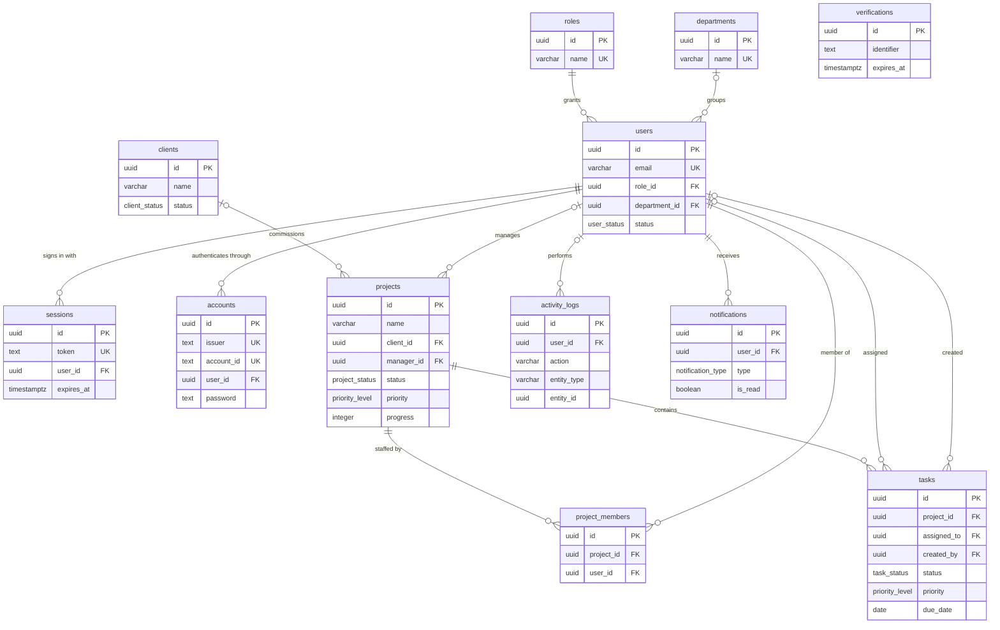

# OPSflow Database Schema

## Overview

OPSflow uses a relational PostgreSQL database to manage organizational users, departments, clients, projects, tasks, notifications, and system activity.

> **This document follows [`packages/db/prisma/schema.prisma`](../packages/db/prisma/schema.prisma).**
> The Prisma schema is the executable source of truth; this file and
> `db_schema.dbml` are documentation artifacts that describe it. When the two
> disagree, the Prisma schema is correct.

The database is designed around the following principles:

- Strong relational integrity
- UUID primary keys
- Explicit foreign-key relationships
- Role-based access control
- Auditability
- Query performance through indexes
- Extensibility for future features

---

# Entity Overview

Keys and the columns that distinguish each entity are shown below. Full column
lists follow in the per-table sections, and `db_schema.dbml` holds the
complete ERD source for [dbdiagram.io](https://dbdiagram.io).



`||` marks a required parent and `|o` an optional one, matching the nullability
of each foreign key. A user must have a role but need not have a department; a
project may exist without a client or a manager; and a task outlives both its
assignee and its creator.

`verifications` has no foreign keys. Better Auth uses it for email and
password-reset tokens, which are keyed by an identifier string rather than a
user id.

---

# Tables

## 1. `roles`

Defines the access level of each user.

### Columns


| Column      | Type        | Nullable | Description           |
| ----------- | ----------- | -------- | --------------------- |
| id          | UUID        | No       | Primary key           |
| name        | VARCHAR(50) | No       | Role name             |
| description | TEXT        | Yes      | Role description      |
| created_at  | TIMESTAMPTZ | No       | Creation timestamp    |
| updated_at  | TIMESTAMPTZ | No       | Last update timestamp |


### Supported Roles

- `admin`
- `manager`
- `employee`

---

## 2. `departments`

Represents organizational departments.

### Columns


| Column      | Type         | Nullable | Description            |
| ----------- | ------------ | -------- | ---------------------- |
| id          | UUID         | No       | Primary key            |
| name        | VARCHAR(100) | No       | Department name        |
| description | TEXT         | Yes      | Department description |
| created_at  | TIMESTAMPTZ  | No       | Creation timestamp     |
| updated_at  | TIMESTAMPTZ  | No       | Last update timestamp  |


### Example Departments

- Management
- Engineering
- Design
- Operations
- Finance

---

## 3. `users`

Stores application users and their organizational information.

This table is **both** the Better Auth user record and the OPSflow employee
profile. There is deliberately no separate profile table and no `auth_id`
column — see [Authentication Architecture](#authentication-architecture).

### Columns


| Column         | Type         | Nullable | Description                          |
| -------------- | ------------ | -------- | ------------------------------------ |
| id             | UUID         | No       | Primary key                          |
| name           | VARCHAR(150) | No       | User's full name                     |
| email          | VARCHAR(255) | No       | Unique email address                 |
| email_verified | BOOLEAN      | No       | Better Auth email verification state |
| image          | TEXT         | Yes      | Better Auth profile image            |
| role_id        | UUID         | No       | Foreign key to roles                 |
| department_id  | UUID         | Yes      | Foreign key to departments           |
| phone          | VARCHAR(30)  | Yes      | Phone number                         |
| position       | VARCHAR(100) | Yes      | Job position                         |
| avatar_url     | TEXT         | Yes      | Profile image                        |
| status         | user_status  | No       | Account status                       |
| joined_at      | DATE         | Yes      | Organization join date               |
| created_at     | TIMESTAMPTZ  | No       | Creation timestamp                   |
| updated_at     | TIMESTAMPTZ  | No       | Last update timestamp                |


`image` and `avatar_url` both exist because the first belongs to Better Auth's
core schema and the second to the OPSflow profile. OPSflow reads `avatar_url`.

### Relationships

```text
users.role_id
    ↓
roles.id

users.department_id
    ↓
departments.id

```

A user belongs to one role and may belong to one department.

`role_id` is NOT NULL, so no user can exist before the roles are seeded. New
signups are assigned the least-privileged `employee` role by a Better Auth
create hook.

---

## 4. `sessions`

Owned by Better Auth. One row per active sign-in.

### Columns


| Column     | Type        | Nullable | Description               |
| ---------- | ----------- | -------- | ------------------------- |
| id         | UUID        | No       | Primary key               |
| token      | TEXT        | No       | Unique session token      |
| expires_at | TIMESTAMPTZ | No       | Session expiry            |
| ip_address | TEXT        | Yes      | Client address at sign-in |
| user_agent | TEXT        | Yes      | Client user agent         |
| user_id    | UUID        | No       | Session owner             |
| created_at | TIMESTAMPTZ | No       | Creation timestamp        |
| updated_at | TIMESTAMPTZ | No       | Last update timestamp     |


Deleting a user deletes their sessions.

---

## 5. `accounts`

Owned by Better Auth. Holds the credentials behind a user, one row per
authentication method.

### Columns


| Column                   | Type        | Nullable | Description                       |
| ------------------------ | ----------- | -------- | --------------------------------- |
| id                       | UUID        | No       | Primary key                       |
| issuer                   | TEXT        | No       | Credential issuer                 |
| account_id               | TEXT        | No       | Identifier at the issuer          |
| provider_id              | TEXT        | No       | Better Auth provider name         |
| user_id                  | UUID        | No       | Account owner                     |
| access_token             | TEXT        | Yes      | OAuth access token                |
| refresh_token            | TEXT        | Yes      | OAuth refresh token               |
| id_token                 | TEXT        | Yes      | OAuth ID token                    |
| access_token_expires_at  | TIMESTAMPTZ | Yes      | Access token expiry               |
| refresh_token_expires_at | TIMESTAMPTZ | Yes      | Refresh token expiry              |
| scope                    | TEXT        | Yes      | Granted OAuth scopes              |
| password                 | TEXT        | Yes      | Hashed password for credentials   |
| created_at               | TIMESTAMPTZ | No       | Creation timestamp                |
| updated_at               | TIMESTAMPTZ | No       | Last update timestamp             |


### Constraints

```text
UNIQUE(issuer, account_id)

```

Better Auth 1.7.2 keys accounts on `(issuer, account_id)` rather than
`(provider_id, account_id)`. Email-and-password accounts get the issuer
`local:credential`; for OAuth it is the provider's issuer URL, which is why the
column is unbounded `TEXT` rather than a `VARCHAR`.

**Password hashes live here, not in `users`.** Deleting a user deletes their
accounts.

---

## 6. `verifications`

Owned by Better Auth. Short-lived tokens for email verification and password
resets.

### Columns


| Column     | Type        | Nullable | Description                 |
| ---------- | ----------- | -------- | --------------------------- |
| id         | UUID        | No       | Primary key                 |
| identifier | TEXT        | No       | What the token verifies     |
| value      | TEXT        | No       | Token value                 |
| expires_at | TIMESTAMPTZ | No       | Token expiry                |
| created_at | TIMESTAMPTZ | No       | Creation timestamp          |
| updated_at | TIMESTAMPTZ | No       | Last update timestamp       |


---

## 7. `clients`

Stores customers or organizations that the company works with.

### Columns


| Column     | Type          | Nullable | Description           |
| ---------- | ------------- | -------- | --------------------- |
| id         | UUID          | No       | Primary key           |
| name       | VARCHAR(150)  | No       | Contact/client name   |
| company    | VARCHAR(200)  | Yes      | Company name          |
| email      | VARCHAR(255)  | Yes      | Contact email         |
| phone      | VARCHAR(30)   | Yes      | Contact phone         |
| address    | TEXT          | Yes      | Client address        |
| status     | client_status | No       | Client status         |
| notes      | TEXT          | Yes      | Internal notes        |
| created_at | TIMESTAMPTZ   | No       | Creation timestamp    |
| updated_at | TIMESTAMPTZ   | No       | Last update timestamp |


### Relationship

```text
clients
   │
   └──< projects

```

One client can have multiple projects.

---

## 8. `projects`

Projects represent major units of business work.

### Columns


| Column      | Type           | Nullable | Description           |
| ----------- | -------------- | -------- | --------------------- |
| id          | UUID           | No       | Primary key           |
| name        | VARCHAR(200)   | No       | Project name          |
| description | TEXT           | Yes      | Project description   |
| client_id   | UUID           | Yes      | Project client        |
| manager_id  | UUID           | Yes      | Project manager       |
| status      | project_status | No       | Project state         |
| priority    | priority_level | No       | Project priority      |
| progress    | INTEGER        | No       | Completion percentage |
| start_date  | DATE           | Yes      | Project start date    |
| deadline    | DATE           | Yes      | Project deadline      |
| created_at  | TIMESTAMPTZ    | No       | Creation timestamp    |
| updated_at  | TIMESTAMPTZ    | No       | Last update timestamp |


### Relationships

```text
projects.client_id
        ↓
    clients.id

projects.manager_id
        ↓
     users.id

```

A project belongs to a client and can have a manager.

---

## 9. `project_members`

Connects users with projects.

This table implements the many-to-many relationship between users and projects.

```text
Users                         Projects

User A ───────────────┐
                      │
User B ───────────────┼──── Project 1
                      │
User C ───────────────┘

User A ───────────────────── Project 2

```

### Columns


| Column     | Type        | Nullable | Description           |
| ---------- | ----------- | -------- | --------------------- |
| id         | UUID        | No       | Primary key           |
| project_id | UUID        | No       | Project foreign key   |
| user_id    | UUID        | No       | User foreign key      |
| joined_at  | TIMESTAMPTZ | No       | Date added to project |


### Constraints

A user cannot be added to the same project twice.

```text
UNIQUE(project_id, user_id)

```

---

## 10. `tasks`

Tasks represent individual units of work within projects.

### Columns


| Column       | Type           | Nullable | Description           |
| ------------ | -------------- | -------- | --------------------- |
| id           | UUID           | No       | Primary key           |
| project_id   | UUID           | No       | Parent project        |
| assigned_to  | UUID           | Yes      | Assigned employee     |
| created_by   | UUID           | Yes      | User who created task |
| title        | VARCHAR(200)   | No       | Task title            |
| description  | TEXT           | Yes      | Task details          |
| status       | task_status    | No       | Current task state    |
| priority     | priority_level | No       | Task priority         |
| due_date     | DATE           | Yes      | Task deadline         |
| completed_at | TIMESTAMPTZ    | Yes      | Completion timestamp  |
| created_at   | TIMESTAMPTZ    | No       | Creation timestamp    |
| updated_at   | TIMESTAMPTZ    | No       | Last update timestamp |


### Relationships

```text
tasks.project_id
       ↓
projects.id

tasks.assigned_to
       ↓
users.id

tasks.created_by
       ↓
users.id

```

Every task belongs to a project.

A task may be assigned to a user.

---

## 11. `activity_logs`

Records important actions performed within the system.

### Columns


| Column      | Type         | Nullable | Description                |
| ----------- | ------------ | -------- | -------------------------- |
| id          | UUID         | No       | Primary key                |
| user_id     | UUID         | Yes      | User who performed action  |
| action      | VARCHAR(100) | No       | Action performed           |
| entity_type | VARCHAR(50)  | No       | Type of affected entity    |
| entity_id   | UUID         | Yes      | ID of affected entity      |
| description | TEXT         | Yes      | Human-readable description |
| metadata    | JSONB        | Yes      | Additional structured data |
| created_at  | TIMESTAMPTZ  | No       | Activity timestamp         |


An activity record is never updated, so the table has no `updated_at`.

### Example

```json
{
  "old_status": "in_progress",
  "new_status": "completed"
}

```

### Example Activity

```text
User:
John Kamau

Action:
updated

Entity:
task

Description:
John completed "API Integration"

Metadata:
{
  "old_status": "in_progress",
  "new_status": "completed"
}

```

---

## 12. `notifications`

Stores user notifications.

### Columns


| Column     | Type              | Nullable | Description            |
| ---------- | ----------------- | -------- | ---------------------- |
| id         | UUID              | No       | Primary key            |
| user_id    | UUID              | No       | Notification recipient |
| title      | VARCHAR(200)      | No       | Notification title     |
| message    | TEXT              | No       | Notification content   |
| type       | notification_type | No       | Notification category  |
| is_read    | BOOLEAN           | No       | Read state             |
| created_at | TIMESTAMPTZ       | No       | Creation timestamp     |


`type` has no default: the code that raises a notification always knows which
category it belongs to.

### Example

```text
You were assigned to Project Alpha.

```

---

# Enumerations

## User Status

```text
active
inactive
suspended

```

## Client Status

```text
active
inactive
archived

```

## Project Status

```text
planning
active
on_hold
completed
delayed
cancelled

```

## Task Status

```text
pending
in_progress
blocked
completed

```

## Priority

```text
low
medium
high
critical

```

## Notification Type

```text
task
project
user
system

```

---

# Relationship Summary


| Relationship              | Type         |
| ------------------------- | ------------ |
| Role → Users              | One-to-Many  |
| Department → Users        | One-to-Many  |
| User → Sessions           | One-to-Many  |
| User → Accounts           | One-to-Many  |
| Client → Projects         | One-to-Many  |
| User → Projects (manager) | One-to-Many  |
| User ↔ Projects           | Many-to-Many |
| Project → Tasks           | One-to-Many  |
| User → Tasks              | One-to-Many  |
| User → Activity Logs      | One-to-Many  |
| User → Notifications      | One-to-Many  |


---

# Delete Behaviour

The database uses deliberate foreign-key deletion strategies.

### `CASCADE`

Used when the child record should not exist without the parent.

Example:

```text
Project deleted
       ↓
Project Members deleted
Tasks deleted

User deleted
       ↓
Sessions deleted
Accounts deleted

```

### `SET NULL`

Used when historical data should remain available.

Example:

```text
User deleted
       ↓
Activity Log remains
       ↓
user_id = NULL

```

### `RESTRICT`

Used when deleting a record could compromise system integrity.

Example:

```text
Role
 ↓
Users

Cannot delete a role that is currently assigned.

```

---

# Indexing Strategy

Indexes are created on frequently queried fields.

### Unique constraints

- `roles.name`
- `departments.name`
- `users.email`
- `sessions.token`
- `accounts.issuer + account_id`
- `project_members.project_id + user_id`

### Secondary indexes

- `users.role_id`
- `users.department_id`
- `users.status`
- `sessions.user_id`
- `accounts.user_id`
- `verifications.identifier`
- `clients.status`
- `projects.client_id`
- `projects.manager_id`
- `projects.status`
- `projects.deadline`
- `project_members.user_id`
- `tasks.project_id`
- `tasks.assigned_to`
- `tasks.status`
- `tasks.due_date`
- `activity_logs.user_id`
- `activity_logs.entity_type + entity_id`
- `activity_logs.created_at`
- `notifications.user_id + is_read`
- `notifications.created_at`

Two of these are composites rather than the separate indexes a first pass might
suggest:

- `project_members` needs no standalone `project_id` index. The
  `(project_id, user_id)` unique constraint is a B-tree with `project_id` as its
  leading column, so it already serves lookups by project.
- `notifications` uses `(user_id, is_read)` rather than two single-column
  indexes, because the hot query is always "unread notifications for one user".

The purpose is to keep common dashboard, filtering, and lookup queries performant as the database grows.

---

# Dashboard Data Sources

The dashboard does not require its own database table in the MVP.

Instead, dashboard metrics are derived from existing entities.

### Example

**Active Projects**

```sql
SELECT COUNT(*)
FROM projects
WHERE status = 'active';

```

**Completed Tasks**

```sql
SELECT COUNT(*)
FROM tasks
WHERE status = 'completed';

```

**Active Employees**

```sql
SELECT COUNT(*)
FROM users
WHERE status = 'active';

```

**Overdue Tasks**

```sql
SELECT COUNT(*)
FROM tasks
WHERE due_date < CURRENT_DATE
AND status != 'completed';

```

This keeps the database normalized and avoids duplicating information.

---

# Authentication Architecture

OPSflow uses **Better Auth**, which writes into this PostgreSQL database
directly rather than delegating to an external identity provider.

```text
Better Auth
      │
      ├── users          ← also the OPSflow employee profile
      ├── sessions
      ├── accounts       ← password hashes live here
      └── verifications
```

An earlier revision of this document assumed an external provider such as
Supabase Auth, reached through a `users.auth_id` column. That indirection was
dropped: Better Auth owns tables in our own database, so a second user record to
point at would be dead weight. `users` therefore carries both the authentication
identity and the OPSflow profile — role, department, position, status — and
there is no `auth_id` column.

Better Auth handles:

- Credentials
- Password hashing
- Sessions
- Verification tokens

OPSflow handles:

- Roles
- Departments
- Business permissions
- User profiles
- Application data

### Passwords

Passwords are never stored in `users`. Better Auth hashes them and writes them
to `accounts.password`, one row per credential, keyed by
`(issuer, account_id)` with the issuer `local:credential`.

### Primary keys

Better Auth generates its own ids by default, and its format is not a UUID.
Because these columns are typed `uuid`, `packages/auth` sets:

```ts
advanced: { database: { generateId: false } }
```

which hands id generation to Prisma's `@default(uuid(7))` and keeps the auth
tables on the same UUIDv7 scheme as the rest of the schema. Ids are therefore
generated by the application, not by a database default.

### Schema ownership

**Better Auth owns `users`, `sessions`, `accounts` and `verifications`,** and it
has changed their shape between minor versions. The `accounts.issuer` column and
the move of the unique key from `(provider_id, account_id)` to
`(issuer, account_id)` were both required by the 1.7.2 upgrade.

After upgrading Better Auth, regenerate its expected schema and diff it against
Prisma:

```bash
pnpm dlx auth@latest generate --config packages/auth/src/index.ts
```

---

# Future Schema Extensions

The schema is intentionally designed to allow future expansion.

Potential additions include:

```text
documents
comments
timesheets
expenses
invoices
reports
project_milestones
teams
custom_roles
permissions
organizations

```

For example, multi-tenant support could eventually introduce:

```text
organizations
      │
      ├── users
      ├── clients
      ├── projects
      └── departments

```

This should not be implemented in the MVP unless multi-organization support becomes an explicit requirement.

---

# MVP Database Scope

The first release should focus on:

```text
roles
departments
users
clients
projects
project_members
tasks
activity_logs
notifications

```

plus the three tables Better Auth requires alongside `users`:

```text
sessions
accounts
verifications

```

This is enough to demonstrate:

- Authentication
- Authorization
- CRUD
- Relational database design
- Many-to-many relationships
- Dashboard analytics
- Audit logging
- Notifications
- Business workflows

---

# Design Principle

The database should support the product's workflow rather than simply mirror the UI.

The core business relationship is:

```text
CLIENT
  │
  └── PROJECT
        │
        ├── MANAGER
        │
        ├── TEAM MEMBERS
        │
        └── TASKS
              │
              └── ASSIGNEE

```

Around that core relationship, OPSflow adds:

```text
AUTHENTICATION
      +
ROLE-BASED ACCESS
      +
ACTIVITY TRACKING
      +
NOTIFICATIONS
      +
DASHBOARD ANALYTICS

```

This provides a strong foundation for the OPSflow MVP while leaving room for future product expansion.
